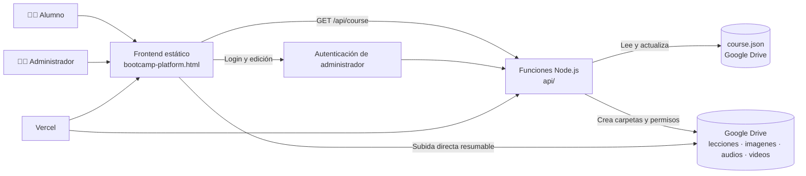

<div align="center">

  

  # Bootcamp Platform

  **Plataforma web de aprendizaje para organizar módulos, lecciones y materiales en un solo lugar.**

  <p>
    Contenido editable · Google Drive como backend · Despliegue serverless en Vercel
  </p>

  <p>
    <a href="#-características">Características</a> ·
    <a href="#-arquitectura">Arquitectura</a> ·
    <a href="#-instalación-local">Instalación</a> ·
    <a href="#-configuración-de-google-drive">Google Drive</a> ·
    <a href="#-despliegue-en-vercel">Despliegue</a>
  </p>

  <p>
    
    
    
    
  </p>

</div>

## Descripción

**Bootcamp Platform** es una plataforma ligera de lecciones para publicar cursos, módulos, materiales y recursos multimedia sin mantener una base de datos tradicional.

El frontend se sirve como una página estática y las funciones de backend se encargan de la autenticación, la lectura y escritura del curso y la preparación de subidas. **Google Drive funciona como una capa de persistencia y almacenamiento administrable**, por lo que el contenido puede mantenerse en una carpeta de Drive sin desplegar un servidor o una base de datos propia.

> La plataforma es pública para los alumnos. Solo las operaciones de administración requieren iniciar sesión.

## Características

| | Funcionalidad |
|---|---|
| 📚 | Organización del curso por módulos y lecciones |
| ✍️ | Edición del contenido y materiales desde la interfaz de administración |
| 📝 | Soporte para texto con Markdown |
| 🎬 | Integración de videos de YouTube, Google Drive o enlaces directos |
| 📄 | Gestión de PDFs y documentos descargables |
| 🖼️ | Imágenes servidas desde Google Drive mediante una función proxy |
| 🎧 | Soporte para audios y recursos multimedia |
| 🔐 | Sesión de administrador con cookie `HttpOnly` firmada |
| ☁️ | `course.json` como fuente de contenido en Google Drive |
| ⚡ | Despliegue sencillo en Vercel con funciones serverless |

## Arquitectura



### Google Drive como backend

La carpeta raíz configurada en `GOOGLE_DRIVE_ROOT_FOLDER_ID` actúa como el espacio de persistencia del proyecto:

```text
Bootcamp/
├── course.json       # Título, módulos, lecciones, textos y enlaces
├── lecciones/        # PDFs y documentos de las lecciones
├── imagenes/         # Imágenes utilizadas por el curso
├── audios/           # Audios grabados o subidos
└── videos/           # Archivos de video, si se almacenan en Drive
```

- `course.json` se crea automáticamente cuando se guarda el curso por primera vez.
- Las carpetas de recursos se crean bajo demanda al recibir la primera subida de cada tipo.
- Las subidas de archivos se realizan directamente desde el navegador hacia Google Drive usando una sesión resumable.
- La API prepara el token y la carpeta, y después finaliza el archivo otorgándole permiso de lectura mediante enlace.
- Los videos también pueden alojarse en YouTube o en Drive y pegarse como enlace desde el panel de administración.

Este enfoque permite usar Drive como un CMS y almacenamiento compartido, manteniendo el código de la aplicación pequeño y sin una capa de base de datos adicional.

## Stack tecnológico

- **Frontend:** HTML, CSS y JavaScript vanilla.
- **Backend:** funciones Node.js compatibles con Vercel Functions.
- **Persistencia:** Google Drive API v3.
- **Autenticación:** contraseña de administrador + cookie firmada con HMAC-SHA256.
- **Desarrollo local:** servidor HTTP incluido en `local-server.js`.
- **Despliegue:** Vercel.

## Requisitos

- [Node.js](https://nodejs.org/) 18 o superior.
- Una cuenta de Google con acceso a Google Drive.
- Un proyecto de Google Cloud con **Google Drive API** habilitada.
- Una carpeta raíz de Drive que pueda ser administrada por la credencial configurada.
- Para producción, una cuenta de Vercel.

## Instalación local

1. Clona el repositorio y entra en la carpeta:

   ```bash
   git clone https://github.com/Dantec01/bootcamp-platform.git
   cd bootcamp-platform
   ```

2. Instala las dependencias:

   ```bash
   npm install
   ```

3. Crea el archivo local de variables de entorno:

   ```bash
   copy .env.example .env.local
   ```

   En macOS/Linux:

   ```bash
   cp .env.example .env.local
   ```

4. Completa las variables de `.env.local` siguiendo la sección [Configuración de Google Drive](#-configuración-de-google-drive).

5. Inicia el servidor:

   ```bash
   npm run dev
   ```

6. Abre [http://localhost:3000](http://localhost:3000).

También puedes utilizar:

```bash
npm start
```

El servidor local carga `.env.local`, sirve `bootcamp-platform.html` y expone las funciones de `api/` para que el flujo de administración se pueda probar sin iniciar sesión en Vercel.

## Variables de entorno

Copia `.env.example` como `.env.local` y configura:

| Variable | Obligatoria | Descripción |
|---|:---:|---|
| `ADMIN_PASSWORD` | Sí | Contraseña del único administrador. |
| `SESSION_SECRET` | Sí | Cadena aleatoria larga para firmar las sesiones. |
| `GOOGLE_DRIVE_ROOT_FOLDER_ID` | Sí | ID de la carpeta raíz de Google Drive. |
| `GOOGLE_SERVICE_ACCOUNT_JSON` | Sí* | JSON completo de la cuenta de servicio en una sola línea. |
| `GOOGLE_SERVICE_ACCOUNT_JSON_FILE` | No | Ruta absoluta al JSON local de la cuenta de servicio. Útil solo en desarrollo. |
| `GOOGLE_OAUTH_CLIENT_ID` | No | Client ID de OAuth para utilizar un Drive personal. |
| `GOOGLE_OAUTH_CLIENT_SECRET` | No | Client secret de OAuth. |
| `GOOGLE_OAUTH_REFRESH_TOKEN` | No | Refresh token de OAuth. |
| `GOOGLE_OAUTH_REDIRECT_URI` | No | URI de redirección; por defecto usa OAuth Playground. |

\* Para autenticación con cuenta de servicio. Si se configuran simultáneamente las tres variables OAuth (`CLIENT_ID`, `CLIENT_SECRET` y `REFRESH_TOKEN`), la aplicación utiliza OAuth en lugar de la cuenta de servicio.

### Generar valores seguros

En PowerShell:

```powershell
node -e "console.log(require('crypto').randomBytes(32).toString('base64url'))"
```

Usa el resultado para `SESSION_SECRET` y define una contraseña fuerte para `ADMIN_PASSWORD`.

> **Importante:** nunca subas `.env.local`, claves JSON, refresh tokens ni contraseñas al repositorio. Estos archivos ya están excluidos mediante `.gitignore`.

## Configuración de Google Drive

### Opción A: cuenta de servicio

Recomendada para una carpeta de Google Workspace o una unidad compartida.

1. Abre [Google Cloud Console](https://console.cloud.google.com/).
2. Crea o selecciona un proyecto.
3. Habilita **Google Drive API**.
4. Crea una cuenta de servicio y descarga su clave JSON.
5. Comparte la carpeta raíz de Drive con el correo de la cuenta de servicio con permiso **Editor**.
6. Copia el ID de la carpeta desde su URL:

   ```text
   https://drive.google.com/drive/folders/<GOOGLE_DRIVE_ROOT_FOLDER_ID>
   ```

7. Guarda el JSON completo en `GOOGLE_SERVICE_ACCOUNT_JSON` o, solo localmente, usa `GOOGLE_SERVICE_ACCOUNT_JSON_FILE`.

### Opción B: OAuth para un Drive personal

Las cuentas de servicio no tienen cuota propia para crear archivos en algunas carpetas de Drive personales de Gmail. En ese caso:

1. Crea credenciales OAuth 2.0 en Google Cloud.
2. Autoriza una cuenta de Google que sea propietaria o editora de la carpeta.
3. Obtén un refresh token.
4. Configura `GOOGLE_OAUTH_CLIENT_ID`, `GOOGLE_OAUTH_CLIENT_SECRET` y `GOOGLE_OAUTH_REFRESH_TOKEN`.
5. Comparte la carpeta raíz con la cuenta autorizada si fuera necesario.

La aplicación detecta automáticamente este conjunto de variables y utiliza OAuth.

## Verificación rápida

Con el servidor iniciado, comprueba que la página responde:

```bash
curl http://localhost:3000
```

Después:

1. Abre la plataforma en el navegador.
2. Inicia sesión desde el acceso de administrador.
3. Consulta el curso para verificar la lectura de `course.json`.
4. Guarda un cambio pequeño y confirma que `course.json` aparece o se actualiza en la carpeta raíz.
5. Sube un archivo de prueba y comprueba que se crea en la subcarpeta correspondiente.

## Endpoints principales

| Método | Endpoint | Uso |
|---|---|---|
| `POST` | `/api/auth/login` | Inicia la sesión del administrador. |
| `POST` | `/api/auth/logout` | Elimina la sesión. |
| `GET` | `/api/auth/me` | Comprueba si existe una sesión válida. |
| `GET` | `/api/course` | Lee el curso desde `course.json`. |
| `PUT` | `/api/course` | Guarda el curso; requiere administrador. |
| `POST` | `/api/upload-session` | Prepara la carpeta y la sesión de subida; requiere administrador. |
| `POST` | `/api/upload-finalize` | Finaliza el archivo y configura su permiso público; requiere administrador. |
| `GET` | `/api/image` | Obtiene una imagen de Drive a través de un proxy. |

## Despliegue en Vercel

1. Sube el repositorio a GitHub.
2. Entra en [Vercel](https://vercel.com/) y selecciona **Add New Project**.
3. Importa el repositorio.
4. No necesitas un build command: el frontend es estático y las funciones viven en `api/`.
5. Añade las variables de entorno en **Project Settings → Environment Variables**:
   - `ADMIN_PASSWORD`
   - `SESSION_SECRET`
   - `GOOGLE_DRIVE_ROOT_FOLDER_ID`
   - `GOOGLE_SERVICE_ACCOUNT_JSON`, o las tres variables OAuth
6. Despliega el proyecto.
7. Comprueba la URL de producción e inicia sesión como administrador.

`vercel.json` redirige la ruta `/` a `bootcamp-platform.html` y configura el comportamiento de caché de la página principal.

## Consideraciones de seguridad

- La contraseña de administrador solo se lee desde variables de entorno.
- La sesión se almacena en una cookie `HttpOnly`, con firma HMAC y duración de 12 horas.
- Las rutas de lectura pública y de edición están separadas: las mutaciones requieren sesión de administrador.
- Los archivos que se suben desde la plataforma se marcan como **cualquiera con el enlace puede ver** para permitir su visualización y embeberlos.
- No publiques la clave privada de Google ni el contenido de `.env.local`.
- Usa una carpeta de Drive separada para producción y limita los permisos de la cuenta que la administra.

## Límites conocidos

- Las funciones serverless de Vercel no son apropiadas para archivos muy grandes.
- La interfaz limita las subidas aproximadamente a **4 MB**.
- Para videos o archivos mayores, súbelos manualmente a YouTube o Google Drive y pega el enlace desde el panel.
- `course.json` debe mantenerse como la fuente estructurada del contenido editable; un PDF no reemplaza el texto que se edita desde la plataforma.
- Google Drive debe mantener los permisos adecuados para que los archivos puedan verse o embeberse.

## Estructura del proyecto

```text
.
├── api/
│   ├── _lib/
│   │   ├── auth.js              # Sesiones y validación de variables
│   │   └── drive.js             # Cliente y operaciones de Google Drive
│   ├── auth/                    # Login, logout y sesión actual
│   ├── course.js                # Lectura y escritura de course.json
│   ├── image.js                 # Proxy de imágenes
│   ├── upload-finalize.js       # Permisos finales del archivo
│   └── upload-session.js        # Preparación de subidas
├── bootcamp-platform.html       # Aplicación frontend
├── local-server.js              # Servidor de desarrollo local
├── vercel.json                  # Rewrites y configuración de Vercel
├── .env.example                 # Plantilla de configuración
└── package.json                 # Scripts y dependencias
```

## Flujo de contribución

1. Crea una rama descriptiva:

   ```bash
   git checkout -b feat/nueva-funcionalidad
   ```

2. Instala dependencias y ejecuta el proyecto localmente.
3. Verifica el flujo de lectura, edición y subida que afecte a tu cambio.
4. Abre un pull request con una descripción clara y capturas cuando el cambio sea visual.

## Licencia

Copyright © 2026 Dantec01. Todos los derechos reservados.

Este proyecto se distribuye bajo una licencia personalizada de uso no comercial. Consulta los términos completos en el archivo [LICENSE](./LICENSE).

Se permite el uso personal, educativo o no comercial, siempre que se conserve la atribución de autoría. El uso comercial requiere autorización previa por escrito y el pago de una licencia al autor.
